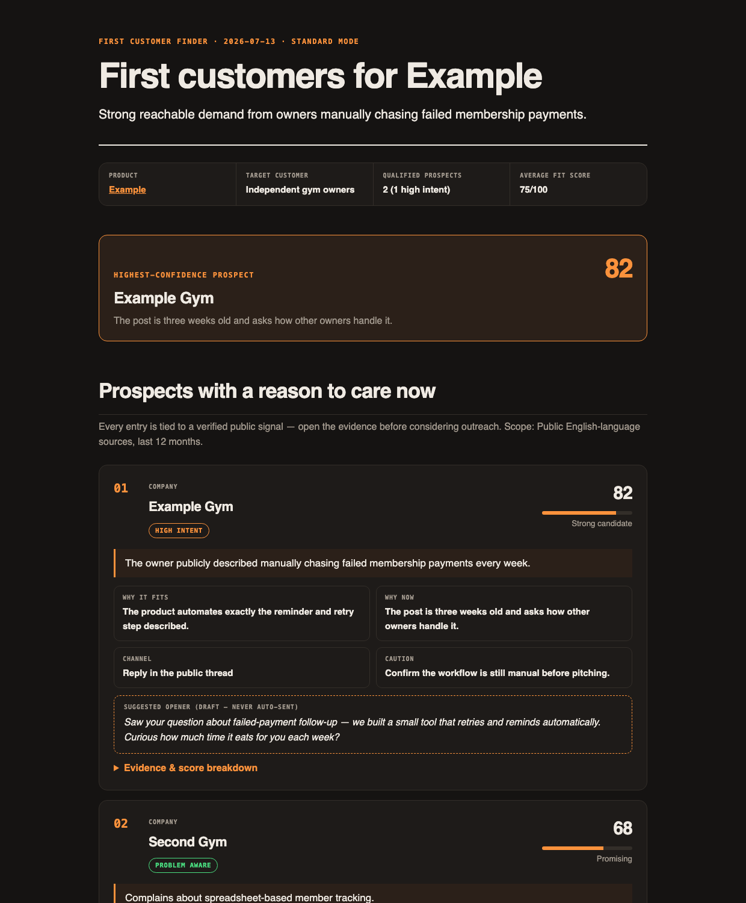

# First Customer Finder — a skill for Claude Code, claude.ai, and Cowork

Give Claude your startup's URL. Get back a shortlist of evidence-backed potential first customers — each tied to a real public signal you can open and read — plus scores, suggested channels, drafted outreach openers, and a polished standalone HTML report.

Research-only by design: it defines your ideal customer profile, mines public discussions for pain and buying signals, verifies every source, and drafts openers. It never sends a message.

## What you get

- Ideal customer profile analysis (primary + adjacent ICP with disqualifiers)
- Parallel public-signal research across five angles: explicit demand, pain, workarounds, switching, timing
- Source verification — every prospect links to the original public page
- Weighted 0–100 qualification score (pain, fit, timing, reachability, evidence quality)
- Personalized outreach openers, grounded only in the cited source
- A seven-day manual validation plan
- A standalone HTML report (light/dark, print-friendly)



*Sample report (fictional demo data). The HTML report is generated on every surface: Claude Code saves it to `outputs/` locally, Cowork and claude.ai offer it as a download from the run's outputs.*

## Install

**Skills CLI** (fastest):

```bash
npx skills add carolinacherry/claude-first-customer-finder-skill
```

**npm installer** (copies into `~/.claude/skills`, respects `CLAUDE_CONFIG_DIR`, `--skills-dir` to override):

```bash
npx --yes claude-first-customer-finder-skill
```

**Claude Code plugin** (this repo is its own marketplace):

```
/plugin marketplace add carolinacherry/claude-first-customer-finder-skill
/plugin install first-customer-finder@carolinacherry
```

**Claude desktop app / Cowork**: download `first-customer-finder.zip` from [Releases](https://github.com/carolinacherry/claude-first-customer-finder-skill/releases), then Settings → Skills → Add → Upload a skill.

**Manual**:

```bash
git clone https://github.com/carolinacherry/claude-first-customer-finder-skill.git
node claude-first-customer-finder-skill/scripts/install.js
```

## Use

Start a new session and ask naturally:

```
Find ten potential first customers for https://yourstartup.com
```

Modes: `quick` (5 prospects), `standard` (10, default), `deep` (20 + pain-pattern mapping), `design-partners`, `b2b`, `community`. Just mention one: *"run it in b2b mode"*.

## How long it takes

This is a deep-research skill, not a chat answer — it fetches and verifies real pages before anything reaches your shortlist. A `standard` run takes **~10–15 minutes in Claude Code** and **noticeably longer in Cowork** (20–30+ minutes), where each new domain needs a fetch-permission click and agents stall until you answer. To speed things up:

- Say **"quick mode"** — 5 prospects instead of 10 cuts the research roughly in half.
- You can shrink scope **mid-run**: type *"quick mode is fine — wrap up with what's verified"* and it re-plans instead of finishing every search bucket.
- In Cowork, answer permission prompts promptly and pick **"Allow all for this website"** so each domain only asks once.

The research fans out across parallel subagents in both Claude Code and Cowork (sequential elsewhere). On Cowork, expect per-domain permission prompts during source verification — choose **"Allow all for this website"** so each domain asks only once; research clusters on a handful of domains, so the prompts stop quickly. (Each prompt is the skill verifying a source at its original page rather than trusting a search snippet.)

## Privacy & safety rules baked in

- Public, intentionally shared professional/business information only
- No login walls, paywalls, data brokers, scraped contact databases, or personal contact discovery
- No targeting by sensitive traits
- Prospects are labeled "potential customers based on public signals" — never claimed as interested or consenting
- Outreach is drafted, never sent

## Structure

```
.claude-plugin/
  plugin.json                        # plugin manifest
  marketplace.json                   # self-serve marketplace catalog
skills/first-customer-finder/
  SKILL.md                           # workflow hub
  references/research-framework.md   # query buckets, scoring rubric, outreach rules
  references/report-schema.md        # JSON contract for the report generator
  scripts/generate_report.py         # stdlib-only HTML report generator
scripts/install.js                   # npm installer
```

## Credit

Inspired by [codex-first-customer-finder-skill](https://github.com/Kappaemme-git/codex-first-customer-finder-skill) by Francesco Mistero — the Codex original. This is an independent rewrite for Claude: fresh skill text, a source-verification pass before qualification, parallel subagent research, and a new report design.

## License

MIT
